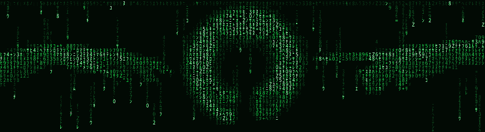

<div align="center">



<a href="https://github.com/vinn-devv">
  
</a>


</div>

```powershell
PS C:\Users\Vinn> neofetch
```

<div align="center">
  
</div>

<div align="center"></div>

```powershell
PS C:\Users\Vinn> ls -la ~/projects
```

| permissions | project | description |
|:--|:--|:--|
| `drwxr-xr-x` | [**gastador**](https://github.com/vinn-devv/gastador) | Allowance budget tracker for students |
| `drwxr-xr-x` | [**Weather-App**](https://github.com/vinn-devv/Weather-App) | Weather app in vanilla HTML, CSS and JS |
| `drwxr-xr-x` | [**inventra**](https://github.com/vinn-devv/inventra) | PHP and MySQL inventory management system |
| `drwxr-xr-x` | [**javascript-reaction-challenge**](https://github.com/vinn-devv/javascript-reaction-challenge) | Reaction-time game |
| `drwxr-xr-x` | [**javascript-github-profile-finder**](https://github.com/vinn-devv/javascript-github-profile-finder) | Search any GitHub profile |
| `drwxr-xr-x` | [**My-To-do-List**](https://github.com/vinn-devv/My-To-do-List) | Simple to-do list app |

<div align="center"></div>

```powershell
PS C:\Users\Vinn> tree ~/stack
```

<p align="center"><b>Languages</b></p>
<p align="center">
  
  
  
  
  
  
</p>
<p align="center"><b>Frameworks &amp; Libraries</b></p>
<p align="center">
  
  
  
  
  
  
  
</p>
<p align="center"><b>Backend &amp; Services</b></p>
<p align="center">
  
  
</p>
<p align="center"><b>Databases &amp; Storage</b></p>
<p align="center">
  
  
  
</p>
<p align="center"><b>Tools &amp; Platforms</b></p>
<p align="center">
  
  
  
  
  
  
</p>
<div align="center"></div>

```powershell
PS C:\Users\Vinn> github --stats vinn-devv
```

<div align="center">
  
  
</div>

<div align="center">
  
</div>

<div align="center"></div>

```powershell
PS C:\Users\Vinn> git log --graph --all --oneline
```

<div align="center">
  
</div>

<div align="center"></div>

```powershell
PS C:\Users\Vinn> open https://github.com/vinn-devv
```

<p align="center">
  <a href="https://github.com/vinn-devv">
    
  </a>
  <a href="https://www.linkedin.com/in/renzo-dev/">
  
</a>
  <a href="mailto:rens.gitlab@gmail.com">
  
</a>
</p>

<p align="center">
  
</p>
